<p align="center">
  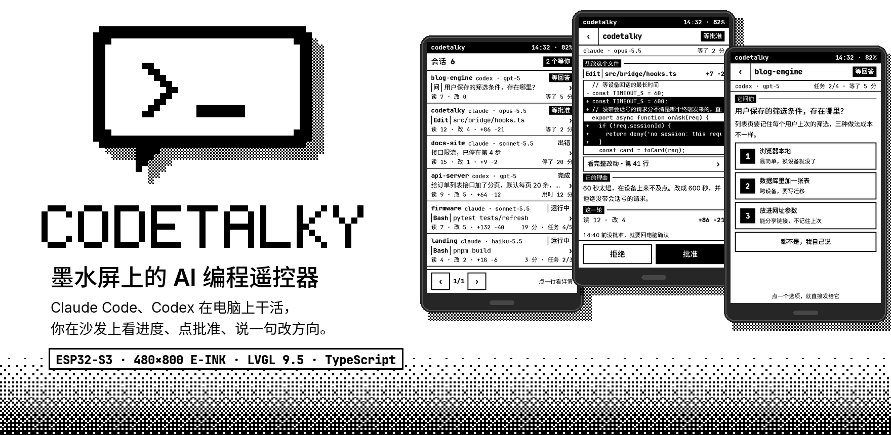
</p>

<p align="center">
  <b>把 Claude Code 和 Codex 装进口袋。</b><br>
  agent 在电脑上干长活，你不用守在终端前：<br>
  在手边的墨水屏上看进度、批准改动、回答它的提问，按住说一句就能给它改方向。
</p>

<p align="center">
  
  
  
  
  
</p>

---

## 它解决什么

让 agent 跑一个大任务，最磨人的是**等**：它随时可能停下来问“能改这个文件吗”“用哪种方案”，人一走开，它就干等着。

CodeTalky 是一块放在手边的墨水屏。电脑上每个 agent 会话在干什么、卡在哪、改了多少，一眼看清；它要你点头的时候，设备上直接批准；它问你问题，点选项或者说一句话就答了。终端里的确认框照常弹出，**哪边先答算哪边**，另一边自动收起。

## 屏幕一览

<table>
  <tr>
    <td align="center" width="25%">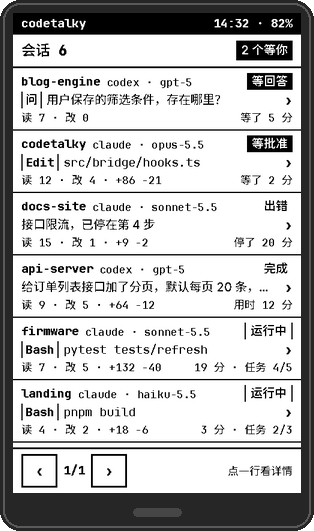<br><b>所有会话</b><br><sub>几台电脑、几个 agent，谁在等你一目了然</sub></td>
    <td align="center" width="25%">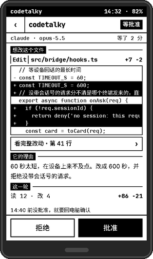<br><b>批准改动</b><br><sub>看 diff、命令和它的理由；危险命令要长按</sub></td>
    <td align="center" width="25%">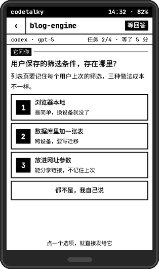<br><b>回答提问</b><br><sub>点一个选项就发出去，或者说你自己的话</sub></td>
    <td align="center" width="25%">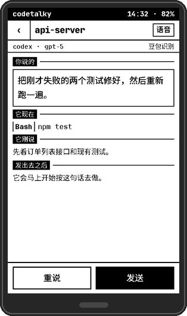<br><b>语音指令</b><br><sub>按住说话，不到一秒出字，确认后发送</sub></td>
  </tr>
  <tr>
    <td align="center">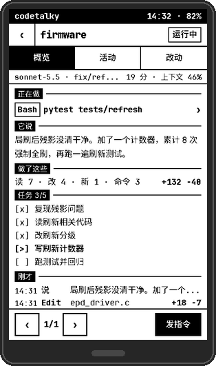<br><b>会话详情</b><br><sub>正在做的一步、待办进度、读写统计</sub></td>
    <td align="center">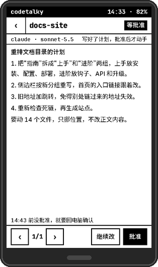<br><b>审计划</b><br><sub>计划模式的方案先过目，批准或打回重写</sub></td>
    <td align="center">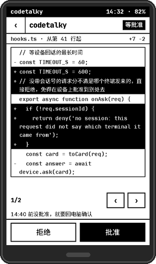<br><b>完整改动</b><br><sub>长 diff 分页看，不用回电脑</sub></td>
    <td align="center">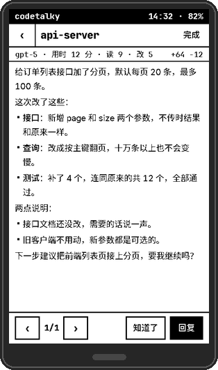<br><b>完成汇报</b><br><sub>做完了什么，下一步建议，一键回复</sub></td>
  </tr>
  <tr>
    <td align="center">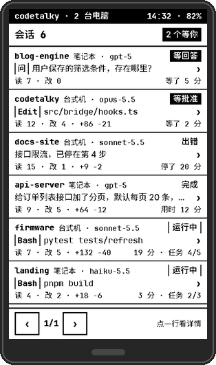<br><b>多台电脑</b><br><sub>台式机、笔记本同时连，会话标明在哪台</sub></td>
    <td align="center">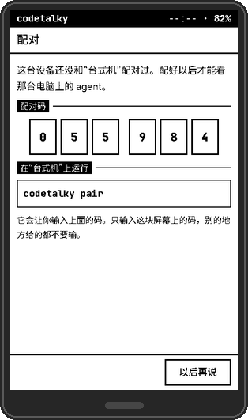<br><b>配对</b><br><sub>6 位码配对一次，以后自动认得、全程加密</sub></td>
    <td align="center">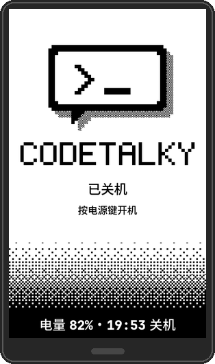<br><b>关机画面</b><br><sub>像素风 Logo，记下关机时的电量和时间</sub></td>
    <td align="center" valign="middle"><sub>以上都是网页仿真器的截图，<br>和真机跑的是同一份界面代码</sub></td>
  </tr>
</table>

## 能做什么

- **实时看到每个会话**：Claude Code 和 Codex 通过钩子把每一步报给电脑端服务，设备上显示正在执行的命令、待办进度、改了哪些文件、加减多少行，以及它最后说的话。
- **在设备上批准和回答**：权限请求、计划审批、`AskUserQuestion` 提问都能在设备上处理。没连设备或期限内没回话，就照常在终端里答。
- **插话和打断**：用 `codetalky claude` 启动的会话，设备能直接给它发指令。它正在干活时，可以**插话**（做完这一步就看到，用来转向），也可以**打断**（先停下再说）。
- **子代理也看得见**：子代理的动作标在所属会话里；主代理收工等后台子代理时，设备上不会误报“完成”。
- **语音**：按住 BOOT 键说话，录音经加密连接送到电脑，用豆包流式语音识别 2.0 转成文字，通常不到一秒。
- **多台电脑、自动发现**：每台电脑跑一个电脑端服务，设备用 UDP 广播自动找到它们并同时连上。
- **安全**：只走局域网。第一次连接用 6 位码配对（X25519 交换密钥），之后的消息全部用 ChaCha20-Poly1305 加密（[Monocypher](https://monocypher.org/)）。
- **无线更新固件**：`codetalky firmware` 推送新固件，设备校验 SHA-256 后切换分区；新固件连不上电脑就自动回滚。
- **为墨水屏调过**：只刷新变化的像素，先黑白快刷再叠灰阶；位图字库按 1 位屏的需要做了网格对齐；中文断行遵守标点规则；关机前把屏幕刷干净。

## 工作原理

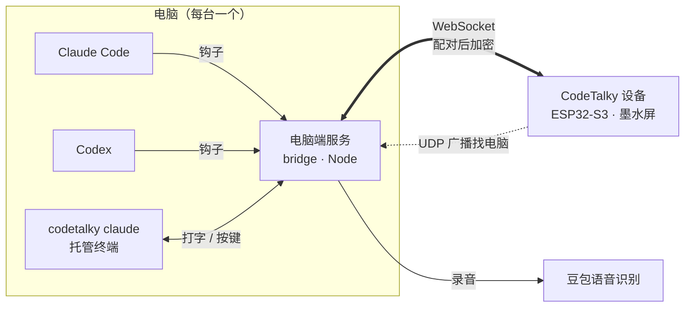

- **钩子**：Claude Code 的 `PreToolUse`、`PermissionRequest`、`Stop` 等事件 POST 给电脑端服务。权限请求挂起等设备回话，期间终端照常显示确认框。
- **托管终端**：`codetalky claude` 在伪终端里运行 `claude`，看起来和直接运行一样，但设备发来的指令能打进去。
- **设备**：界面是 C + LVGL 9.5，同一份代码编译成真机固件和 WebAssembly 仿真器。协议见 [docs/PROTOCOL.md](docs/PROTOCOL.md)。

## 硬件

[Metalio E-INK4](https://github.com/CloudZao/Metalio-E-INK4)：ESP32-S3（16 MB 闪存、8 MB PSRAM）、480×800 墨水屏（SSD1677）、触摸屏、按键、麦克风、电池。固件只用了它的硬件，界面和系统是这个仓库自己写的；出厂系统存在闪存 NVS 里的 Wi-Fi 设置会被直接沿用，不擦除。

## 快速开始

需要：Node 22.18+（开发和实测都在 Windows 上，其他系统没测过）；编译仿真器和固件要 WSL 或 Linux。

### 1. 先在仿真器里看看

不用硬件。字体文件不在仓库里，按 [third_party/fonts/README.md](third_party/fonts/README.md) 下载后：

```sh
# 生成位图字库
uv run --with freetype-py -- python -I tools/fontpack/build_fonts.py tools/fontpack/fonts.json

# 编译仿真器（WSL，需要 ~/emsdk 里的 Emscripten）
bash simulator/build.sh

# 带六个演示会话启动，打开 http://127.0.0.1:8137
cd bridge && npm install && npm run demo
```

### 2. 接上你的 Claude Code

```sh
cd bridge
npm install && npm link                          # 装上 codetalky 命令
codetalky hooks --merge ~/.claude/settings.json  # 加钩子（原文件留一份 .codetalky.bak）
codetalky --name 台式机                           # 起电脑端服务
```

之后任何终端里的 Claude Code 会话都会出现在设备上。想从设备给它发指令，就用 `codetalky claude` 代替 `claude` 启动，参数照旧。

Codex 用 `codetalky hooks --codex --merge ~/.codex/hooks.json`，进 Codex 后用 `/hooks` 信任一次，再用 `codetalky codex` 启动。

### 3. 真机

```sh
bash firmware/build.sh        # WSL 里编译（ESP-IDF 5.5.4）
.\firmware\flash.ps1          # 第一次用数据线刷（Windows PowerShell）
codetalky pair                # 设备上出现 6 位码，在这里输入
codetalky firmware            # 以后无线更新
```

### 4. 语音（可选）

开通火山引擎的“豆包流式语音识别 2.0”，把 API Key 写进 `~/.codetalky/doubao.json`：

```json
{ "apiKey": "你的 key" }
```

运行 `codetalky voice-test` 检查，识别资源会自动选好并保存。

## 命令

| 命令 | 作用 |
| --- | --- |
| `codetalky` | 启动电脑端服务（`--name` 设备上显示的电脑名，`--fake` 加演示会话，`--device-log` 打印设备日志） |
| `codetalky claude [参数]` / `codetalky codex` | 代替 `claude` / `codex` 启动，设备可以给它发指令、插话、打断 |
| `codetalky hooks --merge <文件>` / `--remove` | 把钩子加进 agent 的设置 / 拿掉 |
| `codetalky pair` · `devices` · `unpair <名字>` | 配对设备、列出已配对的、撤销 |
| `codetalky firmware [文件]` | 无线推送固件（默认 `firmware/out/codetalky.bin`） |
| `codetalky voice-test [录音]` | 检查语音识别凭据 |

## 仓库结构

| 目录 | 内容 |
| --- | --- |
| [`ui/`](ui) | 设备界面与协议，C + LVGL 9.5，真机和仿真器共用 |
| [`firmware/`](firmware) | 真机固件（ESP-IDF）：墨水屏驱动、触摸、按键、Wi-Fi、音频、电源、无线更新 |
| [`bridge/`](bridge) | 电脑端服务，TypeScript：钩子、托管终端、配对加密、语音识别、固件推送 |
| [`simulator/`](simulator) | 网页仿真器（WebAssembly）和无浏览器截图工具 |
| [`tools/`](tools) | 字库生成、关机画面像素画、README 配图 |
| [`third_party/`](third_party) | cJSON、Monocypher、LVGL 补丁；字体的下载来源 |
| [`docs/`](docs) | 协议、进度记录、计划书 |

## 开发

```sh
cd bridge && npm test && npm run check            # 电脑端测试和类型检查

# 不开浏览器出截图（假 agent + 假时钟，每次的像素都一样）
node simulator/tools/snapshot.mjs out.png --tap 240,248
node simulator/tools/snapshot.mjs out.png --ask question.json --tap 240,144   # 看一个真实提问的排版
bash simulator/tools/render-ui.sh                 # 全部界面 → design/renders/

uv run --no-project --with pillow python -I tools/readme/make_banner.py      # 重新生成 README 配图
```

进度、实测数据和踩过的坑记在 [docs/STATUS.md](docs/STATUS.md)。

## 致谢

[LVGL](https://lvgl.io/) ·
[ESP-IDF](https://github.com/espressif/esp-idf) ·
[更纱黑体 Sarasa Gothic](https://github.com/be5invis/Sarasa-Gothic) ·
[JetBrains Mono](https://www.jetbrains.com/lp/mono/) ·
[Monocypher](https://monocypher.org/) ·
[cJSON](https://github.com/DaveGamble/cJSON) ·
[xterm.js](https://xtermjs.org/) ·
[node-pty](https://github.com/microsoft/node-pty) ·
[豆包语音识别](https://www.volcengine.com/product/voice-tech)
