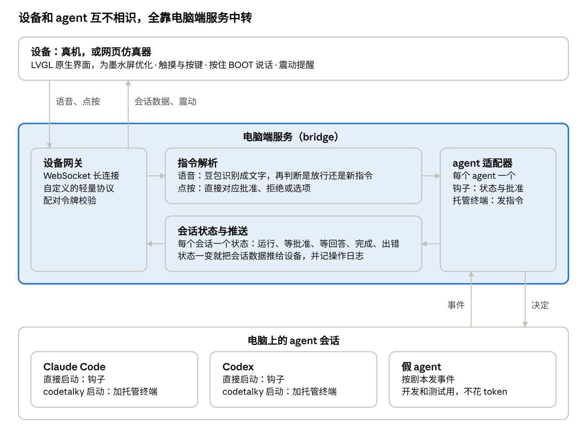
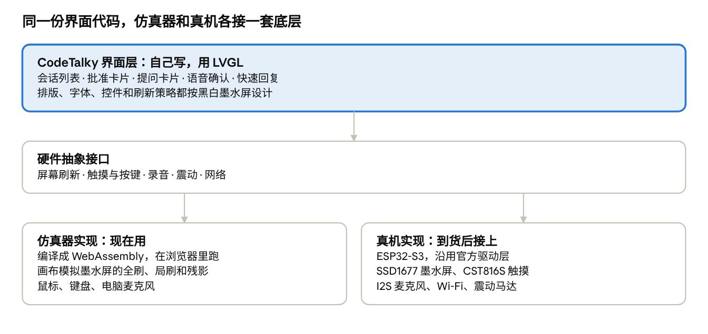
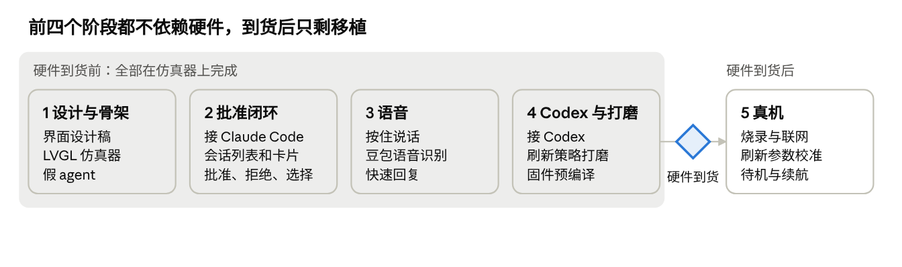

# CodeTalky 项目介绍与计划书

Nov 13, 2026 · @xuys

## 项目简介

CodeTalky 是一个随身的 AI agent 遥控器：在 Metalio E-INK4 墨水屏设备上查看电脑里 Claude Code、Codex 等 agent 的工作状态，并用语音给它们下指令。

它解决的问题很具体：agent 跑长任务时经常停在“等待批准”或“等待回答”上，人一离开电脑，任务就卡住。CodeTalky 让你不在电脑前也能知道谁在跑、谁卡住了，并且一句话或一次点按就放行。

首版只做三件事：

- **看**：每个 agent 会话的状态，例如运行中、等待批准、等待回答、已完成、出错。
- **说**：按住说话，语音转成文字，发给指定的会话。
- **点**：批准、拒绝、选择选项、发送预设的快速回复。

硬件还没到货，所以计划的前半段全部在电脑上用仿真器完成，到货后再把同一套界面和协议搬到真机。

## 硬件概览

Metalio E-INK4 是一台 ESP32-S3 墨水屏手持设备，自带麦克风、扬声器、触屏、震动马达和 Wi-Fi，做 CodeTalky 不需要外接任何东西。

| 部件 | 规格 | 对 CodeTalky 的意义 |
| --- | --- | --- |
| 主控 | ESP32-S3，16 MB Flash，八线 PSRAM | 够跑界面和 Opus 音频编码；语音识别必须放在电脑端 |
| 屏幕 | 3.97 寸黑白墨水屏，数据手册型号 DKE DEPG0397BBS77AF11HP，480×800，235 DPI，显示区约 5.2×8.6 厘米，和银行卡一样大 | 适合常亮看状态；不能滚动，只能分页，要少刷新 |
| 触控 | CST816S 电容触摸，屏幕下方有 HOME、上一页、下一页三个虚拟键 | 点按批准、翻页、返回 |
| 实体键 | BOOT、POWER、音量加、音量减 | BOOT 长按就是按住说话；音量上下键用来翻页 |
| 音频 | I2S 麦克风和扬声器，16 kHz | 语音指令输入；以后可加语音播报 |
| 连接 | 2.4 GHz Wi-Fi；蓝牙只是外置音频芯片，不能传数据 | 设备只能通过网络连到电脑 |
| 提醒 | 震动马达 | agent 等待批准时震动提醒 |
| 电源 | 单节锂电，USB 充电 500 mA；默认 3 分钟无操作进待机 | 待机省电和实时收提醒之间要取舍 |

microSD、时钟芯片、加速度计和 USB 摄像头首版用不到。

官方仓库已克隆到 `D:\CodeTalky\Metalio-E-INK4`（版本 v2.0.63，MIT 许可）。里面有完整固件源码（基于开源的 xiaozhi-esp32，用 ESP-IDF v5.5.4 编译）、屏幕和 IO 芯片的数据手册，以及一个只覆盖电子书阅读页的 LVGL 模拟器。

读完代码后，有四个发现直接决定了后面的方案：

1. **电脑可以直接扮演“云端”。** 设备的语音是 16 kHz 单声道、每帧 60 ms 的 Opus 音频，通过 WebSocket 上传。电脑端服务接住这路音频，就能拿到你说的话。
2. **官方界面是“电脑发 JSON、设备照着画”。** 这套机制叫 A2UI。你决定不用它，界面用 LVGL 自己重做。
3. **固件必须自己编译。** 开源版把所有云端地址留空，而且是编译期常量；自己做界面也本来就要编译和烧录。
4. **驱动层可以直接用。** 官方驱动已经带局刷、快刷和四级灰三套刷新波形，固件用的是 LVGL 9.5，和我们要用的版本一致。

## 目标与范围

首版的验收标准是跑通一个完整闭环：Claude Code 停在权限请求上，设备震动并显示这条请求，你点“批准”或说“批准”，agent 继续跑，全程不碰电脑。

界面不用官方的动态渲染方案，而是用 LVGL 自己重做一套，专门为墨水屏设计和优化。

首版包含：

- **会话列表**：每个会话显示项目、agent、状态、正在做的事、读改了几个文件、加减多少行、用的模型。
- **会话详情**：共三页，音量上下键翻页。概览页是正在做什么、在想什么、做了哪些事、任务进度；活动页是每一步用了什么工具、动了哪个文件；改动页是改了哪些文件、各加减多少行，以及最近一处改动的几行代码。
- **批准卡片**：显示要运行的命令或要改的几行代码，加上 agent 给的理由，带“批准”和“拒绝”两个按钮。另有完成汇报：会话做完时显示 agent 的总结、用时、改了哪些文件、加减多少行、测试结果，可以直接回复下一步。
- **提问卡片**：agent 出选择题时显示选项，点选或说出选项。
- **语音指令**：按住 BOOT 说话，屏上先显示识别出的文字，确认后再发给 agent。
- **快速回复**：几条预设短语一键发送，例如“继续”“先停一下”“跑一下测试”。
- **提醒**：出现新的等待项时震动一次，并刷新屏幕。

agent 的支持顺序是先 Claude Code，后 Codex。

首版明确不做：

- 不显示整份代码和长输出，只显示摘要、改动统计和几行改动预览。屏幕不能滚动，内容多了就分页。
- 不做外网远程访问，设备和电脑在同一个局域网内。
- 不做唤醒词，只按住说话。
- 不做语音播报。
- 不替代电脑上的完整操作，只负责放行和简短指令。

有一个限制会影响使用习惯：查看状态、批准和拒绝，对任何方式启动的 Claude Code 和 Codex 会话都有效；用语音发新指令，则要求会话是用 `codetalky claude` 这样的命令启动的，原因见系统架构。

## 系统架构

系统分三块：设备、电脑端服务、agent。设备和 agent 互不相识，所有消息都经电脑端服务中转。

从上往下走的是你的语音和点按，从下往上走的是 agent 的事件。真机和仿真器接的是同一个设备网关，所以两者可以随时互换。

### 设备这一侧

- 界面用 LVGL 自己写，不用官方的 A2UI 动态渲染。电脑只发会话数据，画面由设备自己画。
- 保留官方固件的驱动层：墨水屏、触摸、录音和 Opus 编码、Wi-Fi、电源。这些没有真机就无法重写和验证。
- 官方的界面和应用（阅读、壁纸、每日清单等）不带，开机直接进 CodeTalky。
- 语音沿用固件现有的录音和编码，传输协议自己定义。

### agent 这一侧

这里把钩子和 [Kiteline](https://github.com/Azure99/kiteline) 的托管终端两种办法合起来用。

Kiteline 不用钩子。它把 Claude Code、Codex 的原生界面跑在一个自己管理的终端里，因此能往会话里打字、读当前屏幕，还能收到程序自己发出的状态和通知（终端转义序列 OSC 7501、OSC 9、OSC 777）。钩子正好相反：拿得到精确的结构化数据，但不能往会话里打字。

| 办法 | 负责什么 | 为什么交给它 |
| --- | --- | --- |
| 钩子 | 看状态；批准和拒绝；回答选择题 | 拿到的是结构化数据：工具名、命令、明确的允许或拒绝，不会按错 |
| 托管终端 | 发新指令（语音、快速回复）；读屏幕摘要；状态的第二来源 | 文字直接粘贴进原生界面再回车，对任何命令行 agent 都一样 |

两种启动方式能做到的事不同：

| 会话怎么启动 | 看状态 | 批准和拒绝 | 发新指令 |
| --- | --- | --- | --- |
| 直接运行 `claude` 或 `codex` | 能 | 能 | 不能 |
| 运行 `codetalky claude` 或 `codetalky codex` | 能 | 能 | 能 |

用 `codetalky` 启动的会话仍是原生界面，在电脑上照常用，区别只是终端由 CodeTalky 托管。有了它，就不再需要之前打算用的 Claude Agent SDK 和 Codex 实验性的 app-server。

会话状态沿用 Kiteline 采用的划分：空闲、运行中、完成、出错，以及等待（细分为等批准、等回答、等登录）。

会话详情里的内容来自 agent 自己的会话记录，钩子负责通知有了新内容。在一份真实的 Claude Code 记录上核对过，里面有模型名、每一步的工具和文件路径、每次修改的逐行补丁、说明文字、git 分支和 token 用量。“在想”显示的是 agent 最近说的一段话，它内部的完整思考不一定拿得到。Codex 的记录格式还没核对。

有两点和 Kiteline 不同。它在 Windows 上自带一套打过补丁的 tmux，我们只需要其中一小部分能力，计划直接用 Windows 自带的伪终端，第 3 阶段开头先验证。另外，Claude Code 和 Codex 实际会发出哪些状态序列还要实测，所以状态以钩子为主。钩子的官方文档：[Claude Code](https://code.claude.com/docs/en/hooks.md)、[Codex](https://learn.chatgpt.com/docs/hooks)。

### 技术选型

设备界面用 C 和 LVGL 9.5 写，仿真器和固件共用同一份代码。电脑端服务和仿真器外壳用 TypeScript 写，跑在 Node 22 上。语音识别用豆包（火山引擎）的云端接口。

## 本地仿真方案

硬件要等一阵子，所以仿真器就是这段时间的主要开发环境：界面用 LVGL 写，编译成 WebAssembly 在浏览器里跑，到货后同一份代码直接编进固件。

界面层只通过一组接口碰硬件。仿真器和真机各实现一遍这组接口，界面代码不用改。

| 真机部件 | 仿真器里的替身 |
| --- | --- |
| 480×800 黑白墨水屏 | 浏览器画布，逐像素黑白；按屏幕数据手册模拟全刷闪烁、局刷延迟和残影 |
| 触摸和三个虚拟键 | 鼠标点击；画布下方三个按钮 |
| BOOT、POWER、音量键 | 页面按钮加键盘快捷键，按住空格就是按住说话 |
| 麦克风 | 电脑麦克风，编码成和真机一样的 16 kHz Opus 帧 |
| 震动马达 | 画布边框闪动加提示音 |
| Wi-Fi 和待机 | 一个开关，模拟断网、待机和重连 |

### 针对墨水屏的优化

“流畅”在墨水屏上的意思是：点了马上有反应，少闪，不留残影。计划从四处下手：

- **刷新分级**：按钮按下这类小变化走局刷，换页走快刷，累计若干次后做一次全刷清残影。三种波形官方驱动都已经带了。
- **只刷变化的区域**：状态变了只重画那一行，不整屏重画。
- **为黑白设计**：不用灰色渐变和动画。层次靠字重、留白、线条和反白；需要灰底时用网点模拟。
- **字体**：中文字体按黑白两色单独调，保证小字清晰。

这些策略先在仿真器的墨水屏模型上调，到货后按真屏校准参数。

文字分两步显示，这是官方驱动在阅读模式里已经在用的做法：操作时先用纯黑白快刷出字，页面停下后再叠加一遍浅灰和深灰，把笔画边缘补平滑。按官方的波形表，叠加这一遍只有 12 帧，不需要 3.2 秒的整屏全刷；实际耗时要到货后测。

字体用更纱黑体。它自带像素对齐信息，纯黑白下笔画粗细和高度最整齐，许可证也允许随固件分发。字库按黑白栅格化的方式自己生成，不用抗锯齿后再二值化的办法。

另外两件事也在到货前做完：

- **假 agent**：一个按剧本发事件的脚本（开始、请求批准、提问、完成、出错）。不花 token 就能反复测界面和边界情况。
- **固件预编译**：把界面层和官方驱动层合在一起，在 WSL 里用 ESP-IDF v5.5.4 编译通过。到货当天只剩烧录。

你的电脑已经有 Node 22、Python 3.13、WSL Ubuntu，以及 `claude` 和 `codex` 命令行。仿真器在 WSL 里用 Emscripten 编译，在 Windows 的浏览器里运行，麦克风和网络都用浏览器现成的。

仿真验证不了、必须等真机的有五项：墨水屏的真实刷新速度和残影、麦克风在真实环境的收音质量、待机后重连 Wi-Fi 的耗时、续航、触摸手感。

## 里程碑计划

计划分五个阶段，前四个在硬件到货前用仿真器完成，第五个是真机移植。

每个阶段都以一个能当面演示的闭环收尾。第 2 阶段做完时，首版最核心的批准功能就已经能在仿真器上用了。

| 阶段 | 交付物 | 怎样算完成 |
| --- | --- | --- |
| 1 设计与骨架 | 主要界面的设计稿、LVGL 仿真器、假 agent | 你认可设计方向；仿真器里能看到按设计稿实现的会话列表，并随假 agent 的状态变化 |
| 2 批准闭环 | Claude Code 钩子适配、批准卡片、提问卡片 | 真实的 Claude Code 会话请求权限，在仿真器上点批准后继续执行；拒绝和选择题同样可用；不理它，超时后仍能在终端里确认 |
| 3 语音 | 托管终端、音频通道、豆包语音识别、快速回复 | 按住说一句中文指令，用 `codetalky claude` 启动的会话收到这句话；说“批准”能放行屏上的请求 |
| 4 Codex 与打磨 | Codex 适配、墨水屏刷新策略、可编译的固件分支 | Codex 会话出现在列表里，能批准、能发指令；仿真器里换页和点按不闪、不拖；固件在 WSL 里编译通过 |
| 5 真机 | 烧录好的设备、校准后的刷新参数、调好的电源策略 | 在真机上重复第 2、3 阶段的验收；刷新观感和仿真器一致；放在桌上工作一天，等待批准时能及时震动 |

这里没有写日期，因为到货时间还不确定。阶段 1 到 4 之间没有外部依赖，可以连续做。

## 风险与待确认问题

最大的风险不在硬件，而在安全：这个设备能让电脑上的 agent 执行命令，误识别或被别人连上都会出事。

已经确认的决定：

- 只在同一个 Wi-Fi 下使用，不做外网访问。
- 语音识别用云端的豆包接口，凭据到第 3 阶段要用时再提供。
- 首版只接 Claude Code 和 Codex。
- 硬件到货还要一阵子，前四个阶段都在仿真器上完成。
- 界面用 LVGL 自己重做并针对墨水屏优化，不用官方的动态渲染。
- 官方固件里的阅读、壁纸、每日清单等应用不保留，开机直接进 CodeTalky。
- agent 接入用钩子加托管终端，借鉴 Kiteline。

| 风险 | 应对 |
| --- | --- |
| 语音误识别导致误批准 | 语音“批准”只作用于屏上正在显示的那一条；删除、强制推送、提权这类命令必须点按确认 |
| 电脑端服务成了电脑的遥控入口 | 只监听局域网；设备用配对令牌连接；只开放批准、拒绝、回答、发消息四种动作；每次远程操作写日志 |
| 托管终端靠模拟键盘输入，原生界面改版后可能打错位置 | 批准和拒绝始终走钩子，不靠模拟按键；托管终端只用来粘贴文字和回车 |
| 语音会上传到火山引擎 | 只在按住说话时上传；接口凭据只存在电脑端，不写进固件 |
| 豆包对中英混说和代码术语的识别率未知 | 第 3 阶段先实测；发送前先显示文字让你确认；点选和快速回复始终可用 |
| 自己做界面，工作量比用官方渲染大，改界面要重新烧录 | 界面在仿真器里迭代；固件带双分区无线升级机制，接到电脑端服务后改完不用插线 |
| 仿真器里的墨水屏和真屏观感有差距 | 参数按数据手册设，到货后第一件事是校准 |
| 待机和实时提醒冲突：现有电源策略 3 分钟无操作进待机，空闲一段时间后会断网 | 改电源策略，保持连接或定时唤醒拉取；具体取舍要在真机上测续航后定 |
| 批准请求有时限：Claude Code 和 Codex 的钩子默认都只等 600 秒 | Claude Code 超时后回到电脑终端里的正常确认，不会误放行；Codex 的超时行为要实测；设备上把过期的请求标出来 |
| 官方接口会变，部分还是预览版或实验性 | 每个 agent 一个独立适配器，接口变了只改一处 |

还需要你确认：

- [x] 界面风格：最初的三个方向已否决，换成内容更全的“工作台”方向，等你确认。

## 下一步

项目骨架和仿真器的编译流程已经就绪，现在等界面方向确认。

1. 你确认“工作台”方向的设计稿：会话列表、三页会话详情、批准、语音确认、完成汇报。
2. 用 LVGL 把这些界面写进仿真器，并接上正式字体。
3. 写假 agent，让界面跟着剧本变化。
4. 在 WSL 里装 ESP-IDF v5.5.4，确认官方固件能原样编译通过。
